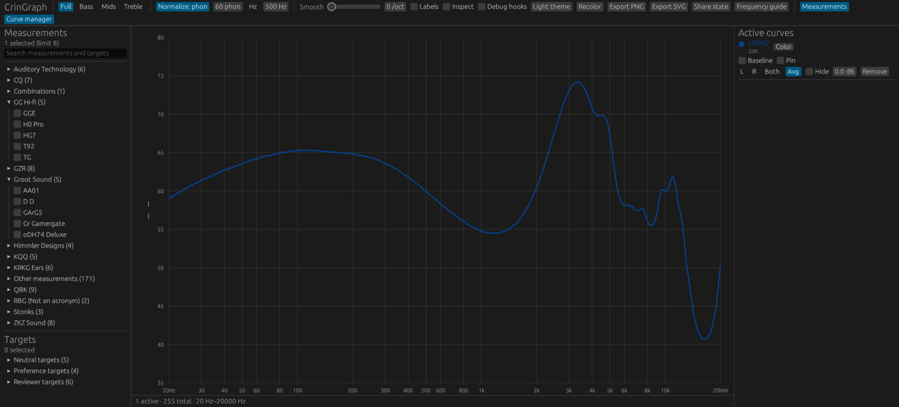

# The In-Ear Graphing Library

If you're not weirdly obsessed with headphones you can leave at any time.

Crinacle is a reviewer famous around the world (at least, I'm on the
opposite side of it as he is) for his extensive reviews and measurements
of in-ear monitors (IEMs). CrinGraph is the tool which allows readers to
compare measurements against each other, and save easily readable images
to share around the internet. Although it was designed for
[Crin's site](https://crinacle.com/graphs/graphtool/),
the code here can be used freely by anyone, with no restrictions.
There are now many instances, including
[Banbeucmas](https://banbeu.com/graph/tool/),
[HypetheSonics](https://www.hypethesonics.com/iemdbc/), and
[Super\* Review](https://squig.link/), which has links to even more of
them. If you're interested in using it for your own graphs, see
[Configuring.md](Configuring.md) and ask me about any questions that
come up.

### What are the squiggles?

If you want the whole story, there's no choice but to get it from
[the man himself](https://crinacle.com/2020/04/08/graphs-101-how-to-read-headphone-measurements/).
5,000 words and you'll still be disappointed when it's over.

The most informative headphone measurement, and the only one handled by
this tool, is the frequency response (FR) graph. An FR graph shows how
loud the headphone will render sounds at different pitches. The higher
the left portion of the graph, the more your brain will rattle; the
higher the right portion of the graph, the more your ears will bleed.
The current industry standard is a "V-shaped" response which applies
both conditions at once. Using an FR graph you may easily see which
headphones conform to this standard and which are insufficiently "fun".

### Sample graphs

This repository includes some sample data so that the tool can be shown
through Github pages. Sometimes I use this to show people features
before they're adopted on Crin's site.

[View some sample graphs.](https://mlochbaum.github.io/CrinGraph/old/graph.html)

The original JavaScript/HTML web app is archived in [`old/`](old/). The
actively maintained application is the native Rust/egui app.

The native interface uses [egui](https://github.com/emilk/egui), an immediate-mode
GUI library for Rust, with [eframe](https://github.com/emilk/egui/tree/master/crates/eframe)
providing the native application framework. They are third-party open-source
projects; CrinGraph's measurement processing and graph implementation are
separate project code.

### Building the native app

#### GNU/Linux

With Rust and Cargo installed, build and run the desktop application:

```bash
cargo run
```

For an optimized Linux build:

```bash
cargo build --release
```

The release workflow also builds Linux x86_64, x86 (i686), ARM hard-float
(armhf), and ARM64 (aarch64) packages. To build a particular Rust target
yourself, pass its target triple to the script (cross targets require the
appropriate toolchain; the workflow uses `cross` for non-host Linux targets):

```bash
./build.sh i686-unknown-linux-gnu
./build.sh armv7-unknown-linux-gnueabihf
./build.sh aarch64-unknown-linux-gnu
```

Without a target argument, `./build.sh` builds for the current machine.

#### Windows

Install [Rust](https://www.rust-lang.org/tools/install) with the MSVC toolchain,
and [Visual Studio C++ Build Tools](https://visualstudio.microsoft.com/visual-cpp-build-tools/)
with the **Desktop development with C++** workload. From PowerShell, run:

```powershell
cargo build --release
.\target\release\crigraph-native.exe
```

The Windows executable is created at `target\release\crigraph-native.exe`.
Build on Windows to produce a Windows executable; binaries are platform-specific.
You can run `build.cmd` from Command Prompt or PowerShell as a build-script
alternative. The workflow publishes Windows x86 (32-bit), x86_64, and ARM64
binaries. The x86 build targets `i686-pc-windows-msvc` and is intended for
Windows 10 32-bit; ARM64 builds run on GitHub's public ARM64 Windows runner.
To choose a target explicitly, pass `i686-pc-windows-msvc`,
`x86_64-pc-windows-msvc`, or `aarch64-pc-windows-msvc` to `build.cmd`.
The 32-bit executable is written to
`target\i686-pc-windows-msvc\release\crigraph-native.exe`.

#### macOS

The Rust application has no platform-specific code, and its GUI dependencies
resolve for both Apple Silicon and Intel macOS targets. macOS builds have not
been runtime-tested in this GNU/Linux environment.

Install Rust with [rustup](https://www.rust-lang.org/tools/install) and the
[Xcode Command Line Tools](https://developer.apple.com/xcode/resources/). Then,
in Terminal, build and run:

```bash
xcode-select --install
cargo run
```

To build an optimized macOS executable:

```bash
cargo build --release
```

The executable is created at `target/release/crigraph-native`. Build on macOS
to produce a native macOS binary; binaries are platform-specific.
You can also build with `./build.sh`.

#### App identity and bundles

`packaging/app.toml` is the shared application manifest. It supplies the
display name, application identifier, desktop metadata, and path to the master
SVG icon in `assets/`. Cargo's build script rasterizes that SVG into density
specific PNGs and Windows ICO/macOS ICNS files; the native window uses the
same app name, application ID, and icon.

Use the platform build scripts to create distributable app folders in `dist/`:

```bash
./build.sh
```

On Windows, run `build.cmd`; it also creates a relocatable `CrinGraph.lnk`
shortcut beside the executable. The Linux bundle includes a desktop entry with
its startup WM class and hicolor icons. A macOS build creates
`dist/macos/CrinGraph-native.app`, including its `Info.plist`, `.icns` icon,
and bundled measurement data. Build bundles on their respective operating
systems.

Generated executables and intermediate build files are written to `target/`;
platform packages are written to `dist/`. They are local build artifacts,
excluded from Git, and should not be included in source commits as source files.
Cargo and the build scripts recreate them when you build the project.

### Automated release builds

Pushing a version tag such as `v1.0.0` starts the GitHub Actions release
workflow. You can also run **Build and release** manually from the Actions tab:
select the source branch or tag, then enter a version tag such as `v1.0.1`.
Manual runs create or update that release tag at the selected source commit.
The workflow builds Linux x86_64, x86, armhf, and aarch64 packages, Windows x86
(32-bit), x86_64, and ARM64 packages, and macOS ARM64 and x86_64 app bundles.
It attaches the Linux `.tar.gz`, Windows `.zip`, and macOS `.zip` bundles
directly to a GitHub Release. These are the
release downloads; they are not nested inside GitHub Actions artifact archives.
Each bundle contains the app identity assets and sample measurement databases.
Run the executable from its extracted `CrinGraph` folder so the bundled `data/`
and `data_hp/` directories are available. The workflow creates a draft release
before building and publishes it only after all architecture builds and
uploads succeed; failed builds leave the release as a draft for inspection or
retry.

### Configuration

The app reads a single `config.toml` from the current user's standard
application configuration directory:

| Platform | Configuration file |
| --- | --- |
| Windows | `%APPDATA%\cringraph\config.toml` |
| GNU/Linux | `$XDG_CONFIG_HOME/cringraph/config.toml`, normally `~/.config/cringraph/config.toml` |
| macOS | `~/Library/Application Support/cringraph/config.toml` |

On first launch, the app creates `config.toml` if it is missing; it does not
replace an existing config. The generated `database_dir` points to the `data/`
folder in the launch working directory, and `headphone_database_dir` is added
when a `data_hp/` folder is present there. Keep the included measurement folders
with the project, or edit the generated file to use their new location.

Platform-specific starter schemas with example paths to the included sample
databases are available in [`config-examples/`](config-examples/):

* [Windows](config-examples/windows/config.toml)
* [GNU/Linux](config-examples/linux/config.toml)
* [macOS](config-examples/macos/config.toml)

Replace the example checkout paths with the actual location of your measurement
folders. These are templates, not automatically installed files; do not copy
them over an existing config unless you intend to replace your own settings.
The config supports default smoothing as well:

```toml
[measurements]
# Paths may be absolute or relative to the directory containing config.toml.
database_dir = "/path/to/data"
headphone_database_dir = "/path/to/data_hp"

[defaults]
# Fractional-octave smoothing level accepted by the UI: 0 through 12.
smoothing_octaves = 5
```

`database_dir` must contain the primary measurement files and its
`phone_book.json`. `headphone_database_dir` is optional; when set, it points to
the additional headphone database (and may contain its own `phone_book.json`).
If either path is omitted, the app keeps its development defaults of `data/`
and `data_hp/` relative to the working directory; the additional database is
skipped if `data_hp/` is absent. With no config file, the default smoothing is
5. Saved UI preferences in the same app configuration directory take precedence
over `smoothing_octaves`; preferences from the previous `CrinGraph-native`
configuration folder are also read for migration.

### Native app screenshot



*Screenshot captured on GNU/Linux.*

Because Crinacle's frequency response measurements are not public, the
sample response curves shown are synthesized. They are not real
headphones and you can't listen to them. To reduce potential
disappointment, steps have been taken to ensure that the curves are as
uninviting as possible. Any resemblance to the exports of a large East
Asian county is purely coincidental.

## Features

If you want one that's not here, just ask so I can explain why it's a
bad idea.

### Layout

The graph tool displays:
* A **graph window** at the top
* The **toolbar** just below it
* The **selector** at the bottom left, or below the toolbar for narrow windows
* A **target selector**
* The **manager** for active curves

### Graph window

* Standard logarithmic frequency (Hz) and sound pressure level (dB) [axes](Documentation.md#axes)
* [Colors](Documentation.md#colors) are persistent and algorithmically generated to ensure contrast
* Use the slider at the left to rescale and adjust the y axis
* [Hover](Documentation.md#highlight-on-mouseover) over or click a curve to see its name and highlight it in the manager

### Toolbar

* Zoom into bass, mid, or treble frequencies
* [Normalize](Documentation.md#normalization) with a target loudness or a normalization frequency
* [Smooth](Documentation.md#smoothing) graphs with a configurable parameter
* Toggle inspect mode to see the numeric response values when you mouse over the graph
* [Label](Documentation.md#labelling) curves inside the graph window
* Save a png [screenshot](Documentation.md#screenshot) of the graph (with labels)
* Recolor the active curves in case there is a color conflict
* Toolbar collapses and expands, along with the target selector, when the screen is small

### Headphone and target selectors

* Headphones are grouped by brand: select brands to narrow them down
* Click to select one headphone or brand and unselect others; middle or ctrl-click for non-exclusive select
* [Search](Documentation.md#searching) all brands or headphones by name
* Targets are selected the same way but are independent from headphones

### Headphone manager

* Curve names and colors are displayed here
* Choose and compare variant measurements of the same model with a dropdown
* Use the wishbone-shaped selector to see left and/or right channels or [average](Documentation.md#averaging) them together
* A red exclamation mark indicates that channels are [imbalanced](Documentation.md#channel-imbalance-marker)
* Change the offset to move graphs up and down (after [normalization](Documentation.md#normalization))
* Select [BASELINE](Documentation.md#baseline) to adjust all curves so the chosen one is flat
* Temporarily hide or unhide a graph
* PIN a headphone to avoid losing it while adding others
* Click the little dots at the bottom left to change a single headphone's [color](Documentation.md#colors)

## Trademarks

Windows is a trademark of Microsoft Corporation. Apple and macOS are trademarks
of Apple Inc., registered in the U.S. and other countries and regions.
Linux is the registered trademark of Linus Torvalds in the U.S. and other countries.
GNU refers to the GNU Project and its software, principally sponsored by the Free Software Foundation, Inc.
These names are used only to identify supported platforms and software; this
project is not affiliated with or endorsed by Microsoft Corporation, Apple Inc.,
Linus Torvalds, the GNU Project, or the Free Software Foundation, Inc.

## Contact

File a Github issue here for topics related to the project. You can also
reach me by the email in my Github profile and the [LICENSE](LICENSE).
I can sometimes be found on
[Crin's Discord server](https://discord.gg/CtTqcCb) where I am
creatively named Marshall. (Original CrinGraph Web Project)
I Don't Currenly have any discord account :-)